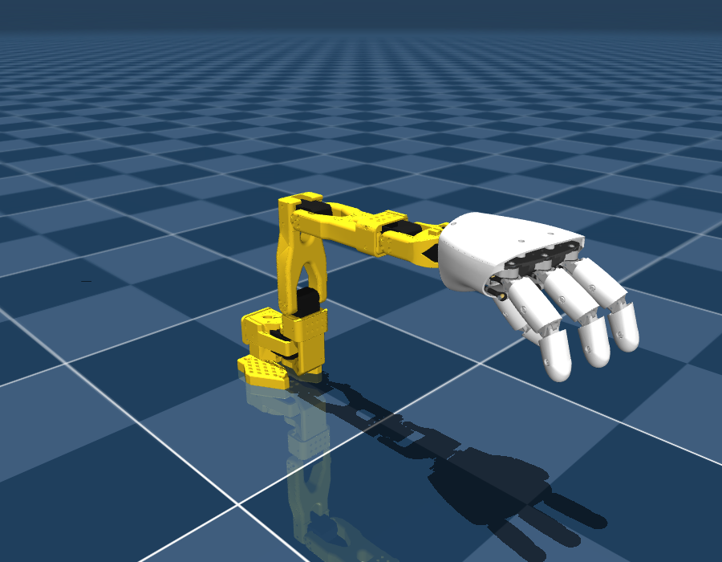

# SO-101 + Amazing Hand – MuJoCo-Modell

Die Hand sitzt über den offiziellen Adapter `SO-ARM_Interface` auf dem Horn des Wrist-Roll-Servos, genau wie
beim realen Umbau.



## Inhalt

| Datei | Zweck |
|---|---|
| `so101_amazing_hand.xml` | Das Robotermodell (Arm + Adapter + Hand) |
| `scene.xml` | Modell + Boden + Licht – zum Anschauen und Steuern |
| `scene_grasp.xml` | Greiftest: Flasche auf einem Tisch, Startpose `grasp_ready` |
| `demo.py` | Beispielskript (Hand öffnen/schließen, Greifen + Anheben) |
| `rps.py`, `gestures.py` | Schere, Stein, Papier in der Simulation |
| `gesture_cam.py` | Erkennt deine Geste per Webcam / ESP32-CAM (MediaPipe) |
| `rps_real.py` | Dasselbe Spiel für die echte Hand (rustypot) |
| `schere_stein_papier.gif` | Aufnahme von drei Spielrunden |
| `assets/` | Alle Meshes (STL) |
| `tools/build_model.py` | Skript, das das Modell aus den Original-Repos neu erzeugt |

## Schritt für Schritt

> **macOS:** Alles, was ein MuJoCo-Fenster öffnet (`demo.py`, `rps.py`), mit **`mjpython`** statt `python`
> starten, z. B. `mjpython rps.py --cam 0`. Das verlangt MuJoCo auf dem Mac. Bei `rps.py` erscheint dort
> kein separates Kamerafenster (macOS erlaubt das nicht zusammen mit dem MuJoCo-Fenster), Runden startest du
> mit Enter im Terminal. Die Kamera selbst prüfst du vorher mit `python gesture_cam.py --source 0`.
> `python -m mujoco.viewer …` und `rps_real.py` laufen normal mit `python`.

### 1. MuJoCo installieren
```bash
pip install mujoco          # getestet mit MuJoCo 4.0.0, Python 3.13
```

### 2. Modell anschauen und von Hand steuern
```bash
python -m mujoco.viewer --mjcf=scene.xml
```
* Rechts im Panel **Control** gibt es einen Schieberegler pro Motor (13 Stück).
* Links unter **Rendering → Group** blendest du mit Gruppe **3** die Kollisionsgeometrie ein (orange).
* Leertaste = Pause, Backspace = Reset. Körper anstoßen: Doppelklick darauf, dann Strg + Rechtsklick-Ziehen.

### 3. Greiftest
```bash
python demo.py --grasp
```
Die Hand schließt sich um die Flasche, danach hebt der Arm sie an (~15 cm).
Manuell geht das auch: `python -m mujoco.viewer --mjcf=scene_grasp.xml`, im Panel **Simulation** den
Keyframe `grasp_ready` laden, dann alle `*_motor1` auf ca. +1,4 und alle `*_motor2` auf ca. −1,4 schieben.


### 4. Schere, Stein, Papier mit Kamera

**Installation** (einmalig; die normale `opencv-python`, nicht `-headless`, weil ein Fenster nötig ist):
```bash
pip install mediapipe opencv-python      # getestet: mediapipe 0.10.32, Python 3.13
```
Beim ersten Start lädt `gesture_cam.py` das Handmodell `hand_landmarker.task` (~7 MB) von Google herunter.

**a) Zuerst nur die Erkennung prüfen:**
```bash
python gesture_cam.py --source 0
```
Es öffnet sich ein Fenster mit dem Kamerabild, dem Handskelett und der erkannten Geste (STEIN / PAPIER /
SCHERE). Unten links stehen die Werte pro Finger (0 = eingerollt, 1 = gestreckt). `q` beendet.

**b) Spielen:**
```bash
python rps.py --cam 0          # Simulation + Webcam
python rps.py                  # ohne Kamera: Wahl im Terminal (1 = Schere, 2 = Stein, 3 = Papier)
python rps.py --auto --cam 0   # Runden starten automatisch
```
* **Leertaste** im Kamerafenster (oder Enter im Terminal) startet eine Runde.
* Die Hand schüttelt dreimal die Faust: "Schere … Stein … Papier!" Schüttle mit und **zeige deine Geste
  bei "Papier!"**.
* Ausgewertet werden die Kamerabilder 0,15–0,8 s nach "Papier!" per Mehrheitsentscheid. Die Bilder davor
  zählen absichtlich nicht, weil dort jeder noch die Countdown-Faust zeigt.
* Wird nichts eindeutig erkannt, zählt die Runde nicht.
* Die Hand wählt ihre Geste per Zufall **vor** dem Countdown und schaut nie auf die Kamera, sie schummelt also nicht.

**Tipps für gute Erkennung:** Handfläche oder Handrücken zur Kamera (nicht seitlich), 30–80 cm Abstand,
gutes Licht, nur eine Hand im Bild.

**Wie gut ist die Erkennung?** Getestet an 210 echten Fotos (je 70 Stein / Papier / Schere, verschiedene
Hintergründe und Haltungen, Datensatz *Shpetim10/rock-paper-scissors*): In 199 Fotos wurde eine Hand
gefunden, davon **97,5 % richtig** (Stein 69/69, Papier 61/62, Schere 64/68). Die Fehler sind fast nur
Seitenansichten, bei denen die Finger hintereinander liegen. Mit einer Live-Webcam konnte ich nicht
testen (keine vorhanden). Getestet sind der Ablauf mit einem simulierten Mitspieler (~11 Bilder/s) und die
Logik von `rps_real.py` mit einem nachgebauten Servo-Controller.

### 5. ESP32-CAM als Kamera

Der ESP32 schickt nur das Bild. Die Erkennung läuft auf dem PC, denn MediaPipe ist für den ESP32 zu groß.

1. Arduino-IDE: Board-Paket **esp32** (Espressif) installieren, Beispiel
   **Datei → Beispiele → ESP32 → Camera → CameraWebServer** öffnen.
2. Das Kameramodell wählen (z. B. `#define CAMERA_MODEL_AI_THINKER`, je nach Version im Sketch oder in `board_config.h`) und `ssid` / `password`
   deines WLANs eintragen. Hochladen.
3. Im seriellen Monitor (115200 Baud) steht die IP, z. B. `192.168.178.57`. Im Browser `http://<IP>` öffnen,
   Auflösung auf **VGA (640×480)** oder **QVGA (320×240)** stellen.
4. Am PC:
   ```bash
   python gesture_cam.py --source http://192.168.178.57:81/stream    # Erkennung prüfen
   python rps.py --cam http://192.168.178.57:81/stream               # spielen
   ```
   Bricht der Stream bei schwachem WLAN ab, nimm Einzelbilder: `--cam http://192.168.178.57/capture`
   (langsamer, aber robuster).

### 6. An der echten Hand

`rps_real.py` spielt dasselbe Spiel über `rustypot`, genau wie Pollens Beispielcode:
```bash
pip install rustypot
python rps_real.py --port COM11 --test                 # erst jede Geste einzeln prüfen
python rps_real.py --port COM11 --cam 0                # mit Webcam
python rps_real.py --port COM11 --cam http://192.168.178.57:81/stream   # mit ESP32-CAM
```
Vorher in der Datei `MiddlePos` (deine Kalibrierwerte) eintragen. `SIDE = 1` (rechte Hand) ist schon gesetzt.
⚠️ Ohne echte Hardware geschrieben: Die Logik ist mit einem nachgebauten Controller getestet, an echten
Servos aber noch nicht.

Die Gesten stehen in `gestures.py`. Es sind Pollens eigene Werte aus `AmazingHand_Demo.py`:

| Geste | Pollen-Funktion | Zeige | Mittel | Ring | Daumen |
|---|---|---|---|---|---|
| Stein | `CloseHand()` | 90 / −90 | 90 / −90 | 90 / −90 | 90 / −90 |
| Papier | `OpenHand()` | −35 / 35 | −35 / 35 | −35 / 35 | −35 / 35 |
| Schere | `Victory()` | −15 / 65 | −65 / 15 | 90 / −90 | 90 / −90 |

### 7. Aus eigenem Python-Code steuern
```python
import mujoco
m = mujoco.MjModel.from_xml_path("scene.xml")
d = mujoco.MjData(m)
mujoco.mj_resetDataKeyframe(m, d, m.key("home").id)

d.ctrl[m.actuator("wrist_roll").id] = 0.5              # Arm: Zielwinkel in rad
d.ctrl[m.actuator("hand_index_motor1").id] = 1.4       # Zeigefinger beugen ...
d.ctrl[m.actuator("hand_index_motor2").id] = -1.4      # ... (beide Motoren gegenläufig)
for _ in range(1000):
    mujoco.mj_step(m, d)                               # 1000 × 2 ms = 2 s
```

## Gelenke und Aktuatoren

Alle Aktuatoren sind **Positionsregler** (Sollwinkel in rad).

| Aktuator | Bereich | Bemerkung |
|---|---|---|
| `shoulder_pan`, `shoulder_lift`, `elbow_flex`, `wrist_flex`, `wrist_roll` | wie Original-SO-101 | Namen und Nullpunkte identisch mit `so101_new_calib.xml` (0 = Mitte des Bereichs) |
| `hand_<finger>_motor1`, `hand_<finger>_motor2` | ±90° | `<finger>` = `index`, `middle`, `ring`, `thumb` |

Der `gripper`-Aktuator des SO-101 entfällt, der Body `gripper` heißt jetzt `wrist_roll_link`.

**Fingersteuerung (2 Servos pro Finger, wie in Pollens Code):**

| Bewegung | motor1 | motor2 |
|---|---|---|
| Beugen (schließen) | + | − (gleicher Betrag) |
| Strecken (öffnen) | − | + |
| Spreizen (seitlich) | + | + bzw. − / − |

Das entspricht `Move_Index(angle1, angle2)` aus `PythonExample/AmazingHand_Demo.py`
(z. B. offen = `(-35, 35)`, geschlossen = `(90, -90)`), nur in Radiant und ohne `MiddlePos`-Offsets.
`demo.py` enthält dafür `set_finger(m, d, "index", -35, 35)` in Grad.

| Finger im Modell | reale Servo-IDs (Pollen-Standard) |
|---|---|
| index | 1, 2 |
| middle | 3, 4 |
| ring | 5, 6 |
| thumb | 7, 8 |

Nützliche Sites: `hand_palm_center` (Mitte der Handfläche), `hand_<finger>_tip` (Fingerspitzen).

## Was gegenüber den Originalmodellen geändert wurde

Grundlage sind die offiziellen, mit *onshape-to-robot* exportierten Modelle von Pollen Robotics (Hand) und
TheRobotStudio (SO-101). Ergänzt bzw. korrigiert wurde:

1. **Montage:** fester Backen, Greifer-Servo und beweglicher Backen entfernt; Adapter `SO-ARM_Interface` auf
   die Hornfläche gesetzt. Die Lage von Adapter und Hand wurde über die Bohrbilder bestimmt
   (6 × M3 Adapter ↔ Handgelenk-Interface, 4 × M3 auf 9,9-mm-Quadrat ↔ Servohorn).
2. **Kollisionen:** Das Original-Handmodell hatte keine. Neu sind die TPU-Shells von Proximal- und
   Distalgliedern sowie Palm- und Top-Shell (jeweils als konvexe Hülle), mit Reibung 1,0.
   Handfläche ↔ eigene Fingerglieder sind ausgeschlossen, Finger untereinander kollidieren.
3. **Fehlende Teile:** Palm-Shell und Top-Shell ergänzt (waren nur als STL im CAD-Ordner).
4. **Masse:** Die Handfläche hatte im Original 1e-9 kg. Jetzt ergibt sich die Gesamtmasse der Hand mit
   **400 g** (Angabe Pollen); Schwerpunkt und Trägheit stammen aus der CAD-Geometrie.
5. **Servos (SCS0009):** Statt kp = 50 ohne Kraftgrenze jetzt kp = 2 N·m/rad, kv = 0,03 und
   ±0,23 N·m Maximalmoment.
6. **Passive Gelenke:** Die Original-Reibung von 0,1 N·m pro Gelenk hat die Finger blockiert. Sie ist jetzt
   auf 0,002 N·m gesetzt.
7. Saubere Namen (`hand_index_distal` statt `parallel_pin_2_x_10__fee063…`), Keyframe `home`,
   Integrator `implicitfast`, elliptische Reibkegel.

## Wichtige Annahmen – bitte mit deiner echten Hardware abgleichen

* **Montagewinkel:** Das Horn hat 4 Schraublöcher, die Hand kann also in 4 Stellungen (90°-Schritte)
  montiert werden. Standard ist **270°**: In Nullstellung zeigt der Handrücken nach oben und der Daumen
  nach innen/unten, wie auf Pollens Foto. Wenn deine Hand anders sitzt, baust du das Modell mit
  `--mount-deg 0|90|180` neu (siehe unten).
* **Nullpunkt `wrist_roll`:** Er hängt davon ab, wie du den Servo in LeRobot kalibriert hast. Vergleiche die
  Handstellung bei `wrist_roll = 0` mit der echten Hand.
* **Finger-Nullpunkt:** Sim-0° ist die CAD-Pose (Finger leicht gebeugt). Deine realen `MiddlePos`-Werte
  verschieben das um einige Grad.
* **Servo-Dynamik und Massen sind Schätzungen**, nicht identifiziert. Für Sim-to-Real (z. B. RL) solltest du
  kp/kv/Reibung messen oder per Domain Randomization variieren.
* **Kollisionen = konvexe Hüllen:** Für Griffe gut genug, aber konkave Details (Fingerkuppen-Mulden,
  Innenseite der Handfläche) sind vereinfacht.
* Nur **rechte Hand** und **new calibration** des SO-101.

## Modell neu bauen (z. B. anderer Montagewinkel)
```bash
mkdir src && cd src
git clone https://github.com/pollen-robotics/AmazingHand.git
git clone https://github.com/TheRobotStudio/SO-ARM100.git
cd ..
pip install mujoco trimesh scipy
python tools/build_model.py src so101_amazing_hand_neu --mount-deg 270
```
Alle Parameter (Massen, Servo-Werte, Reibung) stehen oben in `tools/build_model.py`.

## Lizenzen / Quellen
* Amazing Hand – Pollen Robotics, <https://github.com/pollen-robotics/AmazingHand>
  (Software Apache 2.0, Mechanik CC BY 4.0)
* SO-101 – TheRobotStudio, <https://github.com/TheRobotStudio/SO-ARM100> (Apache 2.0)
